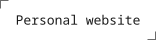

[](https://smturtle2.github.io/)

## 문서 구조

이력서와 포트폴리오는 문서별 자료를 공통 문서 형식으로 변환하고, 같은 출력기로 화면과 인쇄물을 만듭니다.

| 용어 | 책임 |
| --- | --- |
| 문서 `DocumentModel` | 제목, 설명, 언어, 머리말과 본문 전체 |
| 섹션 `Section` | 제목과 자식 섹션·본문 블록을 읽는 순서대로 보관 |
| 역할 `role` | 문서별 CSS 구분. 공통 출력기는 역할 이름으로 분기하지 않음 |
| 본문 블록 `Block` | 문단, 목록, 그림, 갤러리, 표, 수식 |
| 자료 `Asset` | 언어와 무관하게 공유하는 이미지, 수치 표, 다이어그램 |

프로젝트·주제·단계는 포트폴리오의 섹션 역할이고, 분류·항목은 이력서의 섹션 역할입니다.
포트폴리오의 `FLOW`는 `problem → approach → execution → outcome` 순서를 한 번만 정의합니다.
언어별 제목에는 `01` 같은 번호를 쓰지 않습니다.

## 수정할 위치

| 작업 | 위치 |
| --- | --- |
| 문안·캡션·대체 텍스트 변경 | `src/documents/{문서}/content/{언어}.ts` |
| 프로젝트·주제·분류 순서 변경 | 각 문서의 `structure.ts` |
| 포트폴리오 단계별 배치 변경 | `src/documents/portfolio/layout.ts` |
| 문서별 자료를 공통 형식으로 변환 | 각 문서의 `document.ts` |
| 두 문서의 공통 기간·활동 정보·URL 변경 | `src/data/projects.ts` |
| 공통 자료형·출력 결과 검사 | `src/documents/core/` |
| 공통 HTML·제목 계층·번호·배치 처리 | `src/components/documents/` |
| 공통 스타일·문서별 표현 | `src/styles/` |
| 홈의 문서 목록·표시 이름·PDF 파일명 | `src/documents/registry.ts` |
| 빌드용 문서 변환 함수 등록 | `src/documents/factories.ts` |

부제와 링크 이름은 문서마다 다를 수 있으므로 각 문서의 내용 파일에서 관리합니다.
문서 목록은 브라우저에서도 사용하므로 본문·이미지·변환 함수를 가져오지 않습니다.
빌드용 연결은 별도 파일에 두며, 모든 언어의 변환 결과를 검사한 뒤 기존 `/{언어}/{문서}/` 주소를 생성합니다.

## 배치 규칙

섹션의 `children` 배열이 읽는 순서의 기준입니다.
제목 수준은 제목이 있는 섹션의 깊이로 계산하며, 번호는 `numberSections`를 지정한 부모의 자식 섹션에만 붙습니다.
본문 블록과 배치용 HTML 묶음은 제목 수준이나 번호를 늘리지 않습니다.

`layout.kind: 'linear'`에서 `allowBreakAfter`를 생략하면 일반 문서 흐름을 사용합니다.
빈 배열이면 섹션 전체를 가능한 한 같은 페이지에 두고, 자식 섹션 ID를 나열하면 그 뒤에서 나눌 수 있는 묶음을 출력기가 만듭니다.
이 설정은 강제 페이지 넘김이 아니며, 묶음이 한 페이지보다 크면 브라우저가 추가로 나눌 수 있습니다.

`layout.kind: 'columns'`는 마지막 자식 섹션을 옆 열에 놓습니다.
`layout.kind: 'image-aside'`의 `asset`은 현재 섹션에 직접 포함된 그림 하나를 머리말·앞선 본문 옆에 놓고, 그 뒤의 본문은 전체 폭으로 출력합니다.
그림은 자료 ID로 지정하며 같은 섹션에서 정확히 한 번 등장해야 합니다.

## 빌드와 PDF

```sh
npm run dev
npm run build
npm run preview
```

`npm run build`는 `astro check`를 먼저 실행합니다.
필수 단계나 번역이 빠지면 타입 검사에서 실패하며, 자식 섹션·자료 순서가 언어마다 다르거나 배치 참조가 잘못되면 공통 검사에서 실패합니다.
`astro dev`는 타입 검사를 대신하지 않습니다.

문서 페이지에서 `Alt+N`으로 직무명을 수정하면 표시 내용과 PDF 저장용 문서 제목이 함께 바뀝니다.
브라우저에서 인쇄할 때 A4, 배경 그래픽 포함, 브라우저 머리글·바닥글 해제로 저장합니다.
내용이 늘어났을 때의 페이지 수는 고정하지 않으며, 기존 문서 이관 시에는 본문 순서와 페이지 시작 위치를 비교합니다.

## 새 문서 추가

1. `src/documents/{문서}/`에 타입이 있는 구조·언어별 내용과 변환 함수를 만듭니다.
2. 변환 함수는 `DocumentModel`을 반환하며 HTML, 태그 이름, CSS 클래스 문자열을 만들지 않습니다.
3. `registry.ts`에 표시 이름·파일명용 이름을 등록하고 `factories.ts`에 변환 함수를 연결합니다.
4. 기존과 다른 모양이 필요하면 문서별 CSS를 추가합니다.

기존 블록과 배치로 표현할 수 있으면 공통 출력기를 바꾸지 않습니다.
새 종류의 블록이나 배치가 필요하면 공통 자료형·출력 구성요소·CSS를 함께 확장합니다.
